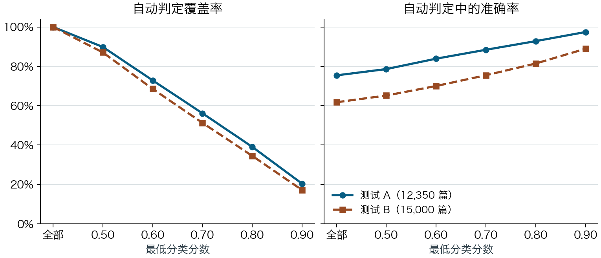
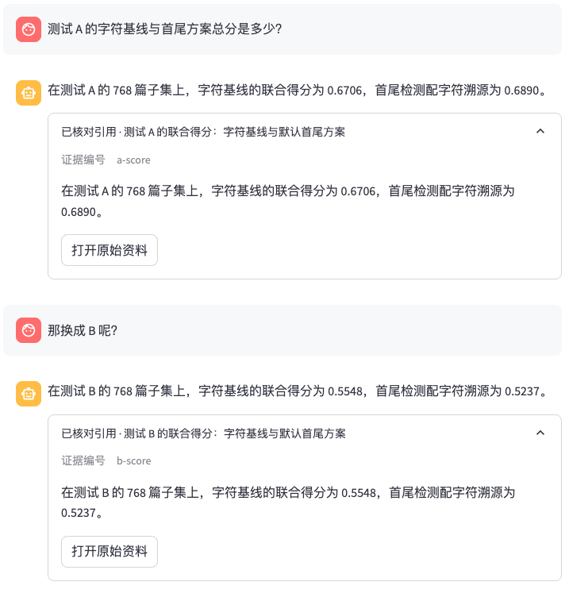
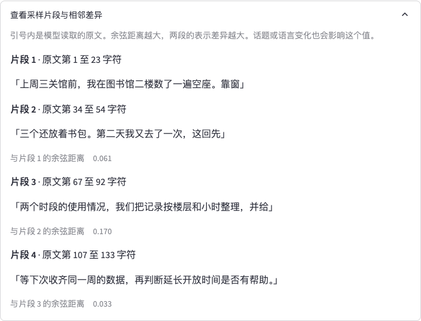
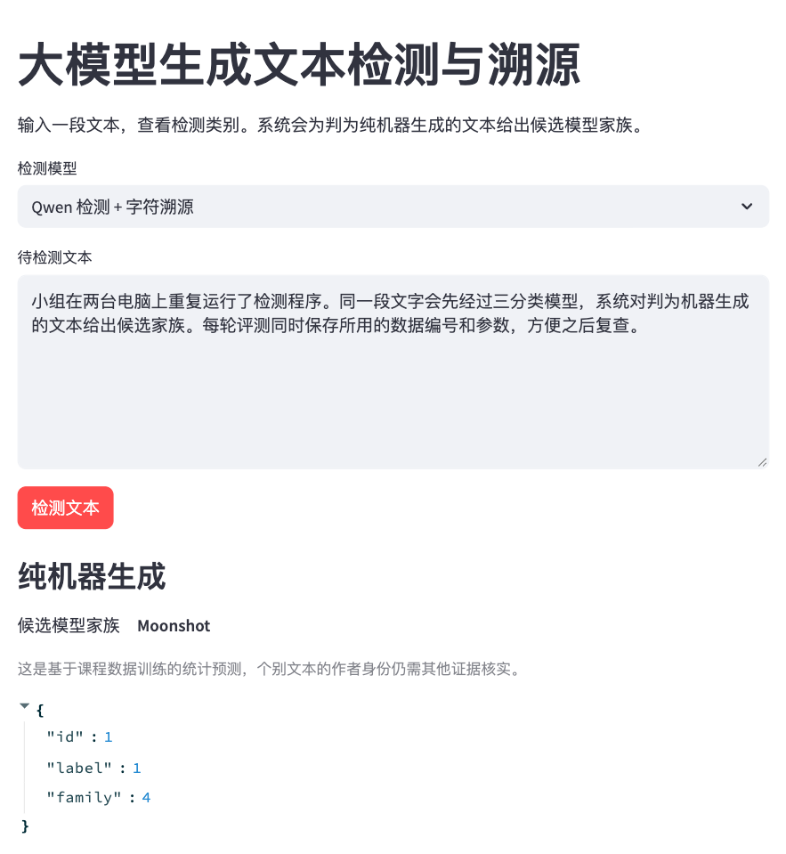

# 大模型生成文本检测与溯源系统

这是《大模型原理与技术》方向 01（NLP）的三人课程项目，选题表第 15 行登记题目为「大模型生成文本检测与溯源系统」。在网页里可以用中文询问标注案例、检测方法或实验结果，追问上一轮，并打开回答引用的原始资料。文本检测页可以对输入给出三分类预测，并为预测为纯机器生成的文本给出候选模型家族。[课程实验报告](REPORT.md)

## 实验结果

| 实验问题 | 实际运行 | 发现 |
|---|---|---|
| 增加标注数据能改善家族溯源吗？ | 五档训练量、三个抽样种子，每次在同一批 19,760 篇上验证 | 训练量从 192 增至 3,072 篇，平均溯源 Macro-F1 从 0.2170 升至 0.4107。[学习曲线和逐档对照](REPORT.md#训练样本量与检测溯源) |
| 分数低的文本优先送审，能找到多少误判？ | 对测试 A、B 全部 27,350 篇评分，比较六种处理方式 | 以 0.70 为门槛，测试 B 有 7,308 篇送审，其中 3,852 篇原判错误。同样多篇随机送审，预期约含 2,796 篇错误。[完整对照和高分误判](REPORT.md#低置信度复核) |
| 长文找得到证据，缺证据时也能拒答吗？ | 两种材料长度、两个档案、四种证据条件，共 16 次真实问答 | 证据位于前、中、后时 12/12 答对。移除目标后 0/4 正确拒答，四次都引用了相似记录。[逐次实答与失败原因](REPORT.md#长文证据的位置与缺失) |



在应用首页点 **查看实验结果与误判案例**，可以切换测试集和复核门槛，逐档查看三次训练结果，也可以把长文中的目标记录移除，查看该条件下归档的模型实答。实验页读取随仓库提供的结果文件，安装基础依赖后即可打开。[实验页实测截图](results/experiment_demo.png)

```bash
python -m pip install -r requirements.txt
python -m streamlit run app.py
```

## 用中文追问证据

在首页选择 **进入溯源证据问答**。先问「测试 A 的字符基线与首尾方案总分是多少？」，再问「那换成 B 呢？」。两次回答引用不同的实验资料。也可问「样本 63 在数据集里标成哪种写作？」，再追问「那它是哪个模型厂商的？」。页面会显示对应案例的编号、原文片段及资料链接。



索引包括 5,120 份依据公开训练标注自动整理的中文案例文档和 19 份项目证据卡。案例保留原文及语言，中文答案取自类别、家族或协作方式字段。31 个项目自编评测问题上，单轮检索答对 15 个，加入案例编号、多轮作用范围和证据校验后答对 26 个。两种方案共用同一 Qwen 因果语言模型。[问答方法与评估](REPORT.md#中文证据问答) · [逐题结果](results/qa_evaluation.json)

最新一轮用另外 24 道自编问题比较了上一版与当前版。答对数从 14 增至 20，8 道资料不足的问题均正确拒答。[逐题结果与检索耗时](research/report.md)

## 四段采样能多识别多少协作文本

从开头、两个中间位置和结尾各取最多 16 个 token，总共最多 64 个。先用四段的平均表示做检测，再用完全相同的文本和模型加入相邻段的差异。测试 A 的 264 篇人机协作文本中，两种方法分别找出 126 篇和 136 篇，同时误报从 61 篇增至 86 篇。首尾模型在同一批 768 篇上的联合得分最高，为 0.6890，网页默认选用它。[对照实验与误差分析](REPORT.md#四段采样与相邻差异) · [完整指标](results/segment_comparison.json)

在网页的 **检测模型** 中选择 **Qwen 四段均值 + 相邻差异**，粘贴文本后点击 **检测文本**。结果下方列出实际读取的原文位置、片段和相邻段的余弦距离。可以用这三个距离观察哪两段变化较大。



## 在这台电脑上演示

工作目录为本项目根目录。已训练的分类器位于 `runs/main/`，Qwen 权重位于 `models/Qwen2.5-0.5B/`。在本机终端启动后，打开终端显示的本地地址，输入文本并点击 **检测文本**。

```bash
.venv/bin/python -m streamlit run app.py
```

本机已经备好官方数据 `data/dataset.zip`、固定划分 `data/course-split/` 和官方测试答案 `data/test_labeled.zip`，可以离线重新训练和评分。

```bash
/opt/anaconda3/bin/python experiment.py --data data/course-split --out runs/local-repeat
/opt/anaconda3/bin/python heldout.py --run runs/local-repeat --input data/course-split --gold data/test_labeled.zip
```



## 从干净环境复现

从个人课程 Fork 获取这一阶段的项目时，可只检出进展分支里的项目目录。

```bash
git clone --filter=blob:none --depth 1 --sparse --branch progress/text-tracing https://github.com/PennyBurden/LLM-Course.git
cd LLM-Course
git sparse-checkout set LLM-Course-Assignments-2026/01-NLP
cd LLM-Course-Assignments-2026/01-NLP/projects/llm-text-tracing
```

推荐 Python 3.11 至 3.13。本次实测版本见报告。先建立虚拟环境，再安装依赖。Windows 可在 PowerShell 运行 `.venv\Scripts\Activate.ps1` 激活环境。

```bash
python -m venv .venv
source .venv/bin/activate
python -m pip install -r requirements-qwen.txt
```

下载赛题仓库中的 `dataset.zip` 和 `test_labeled.zip`，放入本地 `data/` 目录。程序可直接读取 ZIP。首次运行 Qwen 时，Transformers 会获取固定版本的官方权重。也可将已下载的同版模型放入 `models/Qwen2.5-0.5B/` 离线运行。[固定版本的赛题数据](https://github.com/ASCII-LAB/CCKS26-Task6-LLM-Generated-Text-Detect-Trace/tree/09833974f03ca83a52f43830f93913c9a5b26f20) · [Qwen 模型与版本](https://huggingface.co/Qwen/Qwen2.5-0.5B/tree/060db6499f32faf8b98477b0a26969ef7d8b9987)

仅运行领域问答需要 `dataset.zip`、Qwen 权重和以下命令。索引默认写入 `runs/qa-index/`。要重建索引，可用 `--index` 指定新目录，启动网页时将 `TRACE_QA_INDEX` 指向它。

```bash
python rag_qa.py build --data data/dataset.zip
python rag_qa.py ask "样本 63 的生成模型家族是什么？"
python rag_eval.py
python -m qa.long_context
python -m streamlit run app.py
```

批量复核可将历次 `ask` 输出组成 JSON 数组传给 `--history`。传入 `--notes 文件.txt` 会把 UTF-8 材料全文送入模型，并按原文字符位置核对引用。问答评测和长上下文测试的默认输出分别为 `runs/qa-evaluation.json`、`runs/qa-long-context.json`。[固定问题与评判依据](qa/benchmark.json)

需要同时演示文本检测、家族预测和四段分析时，再运行下面的训练与评分步骤。

```bash
python experiment.py --data data/dataset.zip
python heldout.py --input data/dataset.zip --gold data/test_labeled.zip
python -m unittest discover -s tests -v
python -m streamlit run app.py
```

首次训练默认写入 `runs/main/`，包括分类器、逐条验证预测和指标。重复训练会生成带时间的目录，也可用 `--out` 指定一个新目录。评测其他轮次时用 `heldout.py --run 目录`。演示其他轮次时将环境变量 `TRACE_RUN_DIR` 设为该目录。Qwen 自动选择 CUDA、Apple MPS 或 CPU，也可用 `--device cpu` 指定设备。

生成四种基线模型后，在项目根目录执行以下命令即可复现四段实验。两个四段模型、逐条预测及 `summary.json` 写入 `runs/segments/`。网页会自动显示这两个新选项。再次训练时用 `--out` 指定新目录。

```bash
python segment_experiment.py --data data/dataset.zip --gold data/test_labeled.zip
python predict.py --model runs/segments/qwen-segment-change.joblib --text "这里填入待检测的文本。"
```

只跑字符基线时，安装 `requirements.txt` 并执行以下命令即可。已有旧课程固定划分的组员也可以把 `--data` 指向包含 `train.jsonl`、`dev.jsonl`、`dev_gold.jsonl` 的目录。

```bash
python experiment.py --data data/dataset.zip --baseline-only --out runs/baseline
```

报告图直接读取归档的 JSON 指标。安装 `matplotlib==3.10.0` 后，执行 `python results/plot_scores.py` 可重绘检测得分图和家族混淆矩阵，执行 `python results/plot_qa.py` 可重绘中文问答的检索召回曲线。

复跑上面的三组扩展实验时，在项目根目录按下列顺序执行。第一条使用官方训练包，第二条使用已有字符模型及官方测试答案，第三条使用已建好的问答索引与 Qwen 权重。最后一条从归档数据重绘学习曲线和复核门槛图。

```bash
python learning_curve.py
python review_experiment.py
python -m qa.context_sweep
python -m results.plot_experiments
```

## 单条和批量推理

批量输入是 UTF-8 JSONL，每行包含整数 `id` 和字符串 `text`。同一批次的 ID 唯一。人类与协作预测的 `family` 为 `-1`。家族编号 0 至 7 依次对应 OpenAI、Alibaba、DeepSeek、ByteDance、Moonshot、Google、Anthropic 和 xAI。

```bash
python predict.py --model runs/main/qwen-detect-char-source.joblib --text "这里填入待检测的文本。"
python predict.py --model runs/main/qwen-detect-char-source.joblib --input input.jsonl --output runs/predictions.jsonl
```

## 三项任务完成记录

各项负责人与交接时要核对的内容见[报告首页的小组分工](REPORT.md#小组分工)。

| 工作 | 本地交付 | 结果记录 |
|---|---|---|
| 数据与证据 | 核对 126,150 条记录，在完整验证集分析八家族错判，并将 5,120 份训练案例和带出处的实验卡编入检索库 | [数据核验](results/data_and_families.json) · [证据索引](qa/index.py) |
| 检测与问答模型 | 对照首尾和四段表示，接入案例编号、多轮检索、Qwen 受约束生成和引用核验 | [四段实验](results/segment_comparison.json) · [问答实现](qa/engine.py) |
| 评估与演示 | 独立计数复核检测分数，按问答逐轮核对事实与引用，用真实浏览器复核追问、来源、拒答和清空对话 | [检测验收](results/reproduction.json) · [问答评估](results/qa_evaluation.json) · [问答实测](results/qa_demo.png) |

本机的复跑模型和两份逐条测试预测保存在 `runs/team-verified/`。下列命令可在项目根目录复核三项交付。模型与数据已就位时可以离线运行。

```bash
python audit_data.py --data data/dataset.zip --compare-split data/course-split --run runs/team-verified
python window_control.py --data data/course-split --run runs/team-verified
python verify_run.py --data data/course-split --reference runs/main --repeat runs/team-verified
```

在新电脑上复做验收时，先按上文生成 `runs/main`，再用 `experiment.py --out runs/team-verified` 独立训练第二次。用 `heldout.py --run runs/team-verified --out runs/team-verified/test_b.json` 配合同一套输入和答案生成独立测试记录。如果只有官方压缩包，三个复核脚本都支持 `--data data/dataset.zip`，数据核验命令可省略 `--compare-split`。

## 课程登记

选题表第 15 行已登记 **NLP · 大模型生成文本检测与溯源系统**。代码和带学号命名的报告位于个人课程 Fork 的 `LLM-Course-Assignments-2026/01-NLP/`，报告位于该方向的 `submissions/`。课程总说明还列有方向 Issue 报名、三人组队提前申请和向老师仓库提交 PR 的要求。[方向 01 要求](https://github.com/CAI-testbooks/LLM-Course/blob/main/LLM-Course-Assignments-2026/01-NLP/README.md) · [课程流程](https://github.com/CAI-testbooks/LLM-Course/blob/main/LLM-Course-Assignments-2026/README.md)
