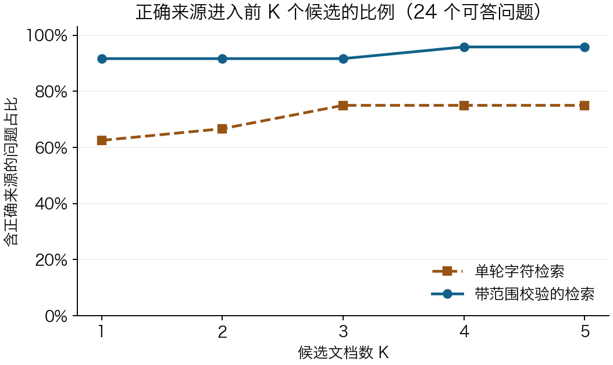
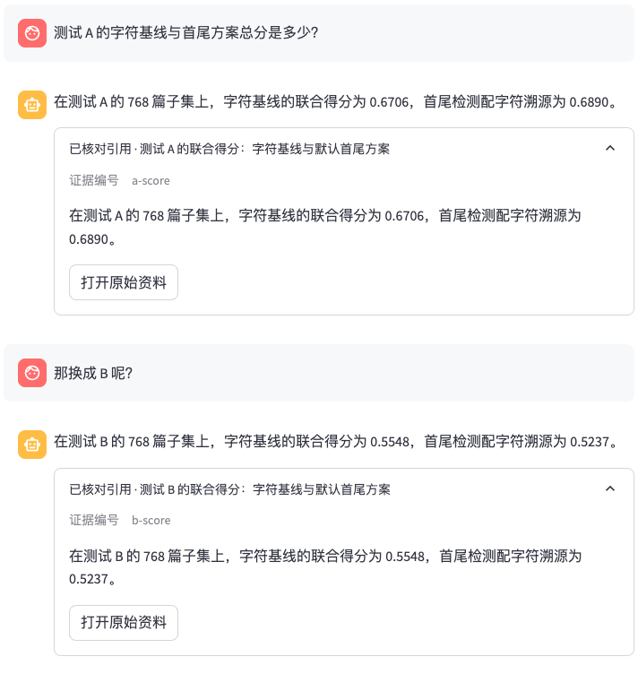
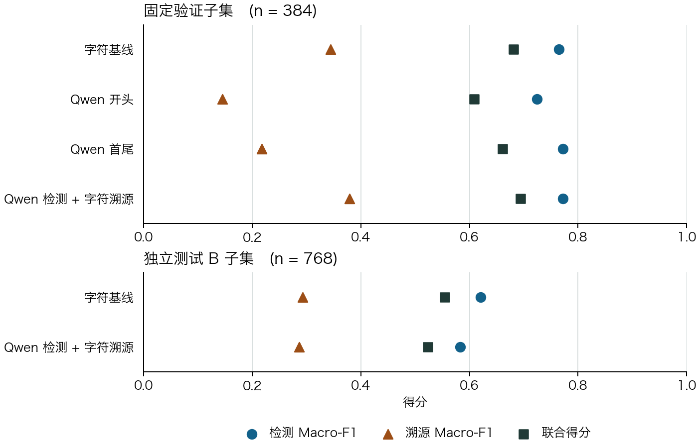
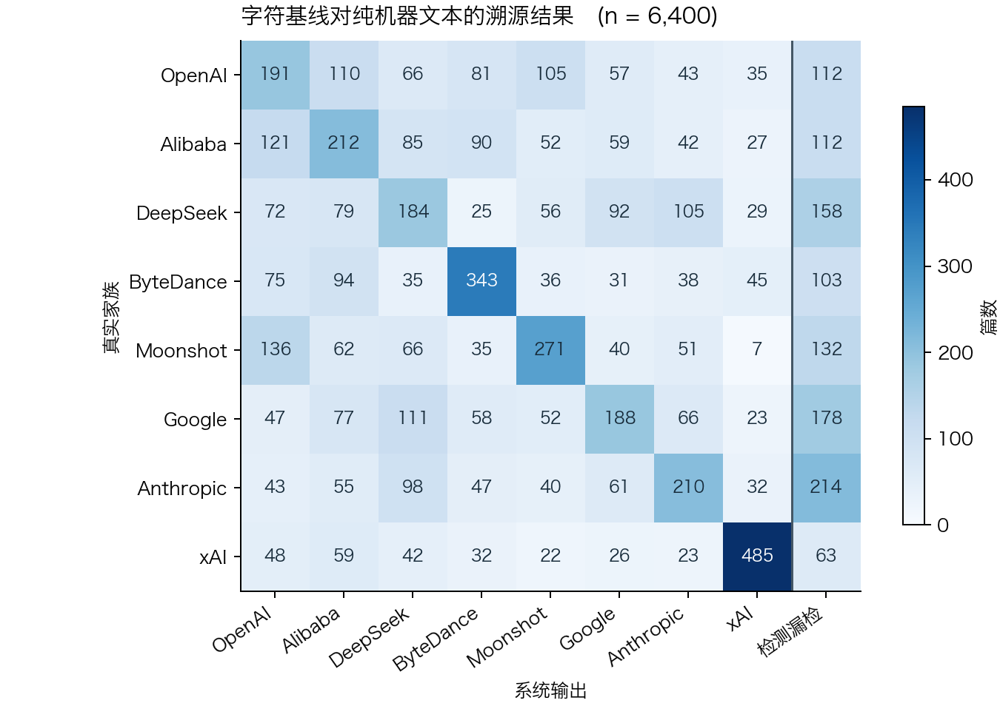

# 大模型生成文本检测与溯源系统

《大模型原理与技术》三人课程项目 · 方向 01 自然语言处理（NLP）

报告提交人　朱浩瑜（SX2616002）

## 项目概述

选题表第 15 行登记的题目为「大模型生成文本检测与溯源系统」。有人问「一篇公开样本是怎样标注的」，也有人问「检测器在测试 A 上得了多少分」。第一类问题需要查数据标注，第二类问题需要查对应的实验记录。本项目把两类证据接入中文多轮 RAG 问答，同时提供文本三分类检测与八家族溯源演示。公开案例的真值、模型对新文本的预测、固定测试子集上的统计各有独立来源。[代码和复现步骤](https://github.com/PennyBurden/LLM-Course/tree/progress/text-tracing/LLM-Course-Assignments-2026/01-NLP/projects/llm-text-tracing) · [课程方向说明](https://github.com/CAI-testbooks/LLM-Course/blob/main/LLM-Course-Assignments-2026/01-NLP/README.md)

在项目新增的 24 道自编问题上，改进检索和证据校验后，系统的答对数从 14 增至 20，8 道依据不足的问题全部正确拒答。文本检测实验中，首尾检测配合字符溯源在测试 A 子集上得分最高，字符基线在测试 B 子集上领先。

## 小组分工

下表列出三位成员当前负责的模块，以及交接时各自要核对的内容。已有代码和实验结果按模块归档。[工作记录与复现步骤](../projects/llm-text-tracing/README.md#三项任务完成记录)

| 成员 | 职责 | 交接时核对的内容 |
|---|---|---|
| **朱浩瑜（队长）** | 负责检测、溯源和中文问答模型，协调进度，统稿并提交课程作业 | 解释首尾检测与四段采样的取舍，核对报告中的模型配置和主要结论 |
| 数据与证据负责人 | 负责数据划分、去重和问答证据库，维护案例编号、标签与出处 | 从样本 63 的回答回到原始标注，核对写作类别和模型家族，并核对索引中的案例数 |
| 评估与演示负责人 | 负责实验评估、结果图表和网页演示，维护运行与复现说明 | 复核测试 A、B 的分数，在网页上演示一次跨测试集追问和一次证据不足时的拒答 |

## 中文证据问答

### 数据、分块与索引

从 CCKS 的固定训练池按 ID 哈希顺序取样，对原文做 Unicode 规范化、空白合并和全文去重，保留 5,120 份不同的原始案例。每个案例根据真实类别及可用的家族或协作方式字段生成一份中文标注问答，链接固定版本的赛题数据，并保留可定位的样本 ID。案例原文保留原语言。按前 500 个字符至少含 24 个汉字的口径，此批原文符合条件的篇数为 0。另有 19 份中文实验和方法证据卡，链接打分文件、程序或报告。案例取自训练部分，证据卡使用已公开的实验汇总。[案例构建与清洗](../projects/llm-text-tracing/qa/index.py) · [证据卡和出处](../projects/llm-text-tracing/qa/cards.json)

5,139 份文档按每块最多 480 字符切分，相邻块重叠 60 字符，得到 21,160 块。SQLite 保存文档、来源、标注答案及原文块。持久化的正文和标题索引共同使用 36,073 维字符二至三元 TF-IDF 稀疏向量，以余弦相似度检索，并按文档 ID 去重。[索引统计和运行环境](../projects/llm-text-tracing/results/qa_evaluation.json)

### 可复核的检索增强生成

单轮基线只按当前问题与正文块的向量相似度检索。优化版先识别案例编号及测试 A、测试 B 或验证集。具体案例按完整编号匹配，避免把 340 错配给 34040。普通实验问题融合正文与标题得分，权重分别为 0.60 和 0.40。追问可以继承上一轮的案例或实验主题，显式指定的新测试集优先。明确点名的方法和指标还须出现在同一份对应实验记录中。没有匹配案例或证据不足时可以拒答。[检索、对话与拒答实现](../projects/llm-text-tracing/qa/engine.py)

两种方案共用同一份冻结的 Qwen2.5-0.5B 因果语言模型。在最多三份候选证据上，模型按 token 在证据原句的前缀树中解码，分叉处结合语言模型分数与检索先验，唯一的后缀直接复制。系统逐字比对输出与带编号的原文，再附来源。用户补充的材料可引用到字符区间，数据库案例可回到真实编号。逐字相符保证引文本身忠实，引用是否回答了用户的问题需用独立指标衡量。[生成器实现](../projects/llm-text-tracing/qa/generator.py) · [Qwen 官方模型](https://huggingface.co/Qwen/Qwen2.5-0.5B)

### 基线比较与误差

在同一份自编基准上比较两套检索策略。27 组对话共 31 轮，含 24 个有证据的问题和 7 个缺少证据的问题。两套方案分别维护自己的对话历史。正确回答按预先写下的必需事实字符串检查，缺少证据时只有拒答算正确。引用 F1 以每轮返回的证据 ID 与标准证据 ID 做微平均。下表的幻觉率代理定义为实际作答中引用错误资料、对不可答问题仍作答或引文未核实的比例。这项口径可复算，未使用主观人工评分。[问题集、预期证据与事实条件](../projects/llm-text-tracing/qa/benchmark.json) · [评估程序](../projects/llm-text-tracing/rag_eval.py)

| 方法 | 答案准确率 | 引用微平均 F1 | 幻觉率代理（每次作答） | 在 7 个不可答问题中正确拒答 |
|---|---:|---:|---:|---:|
| 单轮字符检索 + Qwen | 15/31（48.4%） | 0.509 | 17/31（54.8%） | 0/7 |
| 范围校验、多轮检索 + 同一 Qwen | 26/31（83.9%） | 0.857 | 4/25（16.0%） | 5/7 |

在 24 个可答问题里，正确来源排第一的次数从 15 增到 22。扩大到前 5 份候选后，次数从 18 增到 23。优化版实际作答 25 轮，引文都能逐字核对，其中 4 轮仍引用了与问题不相符的资料。例如，询问样本 63 的家族时能追溯到 Google，询问检测器电费时却返回了训练抽样说明。还有一个关于训练池与验证池规模的问题被错误拒答。该基准由项目自行编写，结论适用于这批问题。下一轮可由未参与知识卡编写的同学收集盲测问题，分别测量越域提问、复合指标和材料缺失时的误答率。[逐轮原始结果](../projects/llm-text-tracing/results/qa_evaluation.json)

### 检索优化复测

上一版的 31 道公开题用作诊断。新版区分数据划分问题和验证集成绩问题，检查证据是否覆盖用户询问的属性，并支持“第 63 号样本”这类编号写法。事实问题只查 19 个事实块，编号案例继续按完整 ID 检索。Qwen、权重、索引内容和评分规则沿用上轮配置。

| 问题集与指标 | 上一版 | 本轮 |
|---|---:|---:|
| 31 道已知开发题答对数 | 26/31 | 31/31 |
| 24 道新增题答对数 | 14/24 | 20/24 |
| 新增题引用微平均 F1 | 0.529 | 0.800 |
| 新增不可答题正确拒答 | 4/8 | 8/8 |
| 新增题中无依据作答 | 9/18 次作答 | 2/14 次作答 |

新增题由同一开发者预先编写，只在候选冻结后运行一轮新旧版本对照。仍有四题失误，包括回答四段误报问题时引用了检出数，以及连续第二次切换测试集时错误拒答。固定样本的本地对照仍需组外盲评。在 34 组查询与范围上，预热后计时 68 对，事实检索中位耗时从 22.11 毫秒降至 0.48 毫秒。单独比较索引加速时，各查询的候选、顺序、分数和证据块完全相同。计时仅覆盖检索。[逐题对照与复现命令](../projects/llm-text-tracing/research/report.md)

### 部署和交互

模型原生上下文为 32,768 个 token。本项目以 YaRN 的 2 倍位置缩放扩展 Qwen，应用将提示与答案的总预算设为 49,152。Mac 上超过 8,192 个提示 token 时，用 MLX 按块建立同一份权重的键值缓存。短问答仍使用 PyTorch。普通问答和长文测试共用问题解析、检索、解码约束与引用校验代码。[长文推理实现](../projects/llm-text-tracing/qa/mlx_context.py) · [位置编码文档](https://huggingface.co/docs/transformers/main/en/internal/rope_utils)

本机实际传入 33,035 个 token 的合成档案，将目标记录放在约第 16,292 个 token 之后，并在末尾放入另一项代号。含问题和候选证据的提示共 **33,180 个 token**，键值缓存覆盖完整提示。系统返回文中正确的「松塔427」，引用与原文字符区间逐字匹配，本次用时 42.03 秒。检索会将候选句再列入提示末尾，本实验检验整条 RAG 通路的长文传入和引用定位。单条合成档案的结果还需更多自然长文验证。[完整实测记录](../projects/llm-text-tracing/results/qa_long_context.json) · [可复现的长文测试](../projects/llm-text-tracing/qa/long_context.py)

Streamlit 把检测和领域问答放在同一应用中。问答页可连续追问、输入补充材料、查看原始来源并清空对话。浏览器实测先查询测试 A，再追问「那换成 B 呢？」，两条回答分别回链到各自的统计记录。对库中不存在的样本编号，页面返回证据不足。[本地启动方法](../projects/llm-text-tracing/README.md) · [网页代码](../projects/llm-text-tracing/pages/1_Evidence_QA.py)

## 研究问题

给一段由人起草、机器续写的文字，只看开头可能会错过续写部分。本项目先检验文本结尾能否帮助冻结的大模型识别人机协作，再考察固定采样预算时，相邻片段的表示变化能否提供额外线索。系统输出检测类别，对判为纯机器生成的文本再给出候选模型家族。

实验沿用先前课程整理的 CCKS 2026 固定训练与验证划分。本次重新实现并运行 Qwen 表示提取、窗口对照、组合模型、独立测试和本地交互演示。下列数字均来自本项目的运行记录。[赛题与数据](https://github.com/ASCII-LAB/CCKS26-Task6-LLM-Generated-Text-Detect-Trace)

## 与已有方法的关系

DetectGPT 利用概率曲率进行零样本生成文本检测。TuringBench 将文本真伪识别与生成器归因设为两个可评测的问题。本项目采用有监督的三分类和八家族分类，在检测和溯源之间显式传递漏检错误。两项论文提供方法背景，本报告的数值对照均在同一份课程样本上重跑。[DetectGPT，ICML 2023](https://proceedings.mlr.press/v202/mitchell23a.html) · [TuringBench，Findings of EMNLP 2021](https://aclanthology.org/2021.findings-emnlp.172/)

## 数据和评测设计

| 用途 | 数据来源 | 可用文本 | 本次使用 | 抽取方式 |
|---|---|---:|---:|---|
| 训练 | 官方训练集的固定训练部分 | 79,040 | 1,536 | 三类各 512，纯机器按家族各 64 |
| 方案比较 | 同一官方训练集的固定验证部分 | 19,760 | 384 | 三类各 128，纯机器按家族各 16 |
| 独立测试 | 官方测试 B | 15,000 | 768 | 按 split 与 ID 的哈希取样，标签不参与选样 |
| 四段实验的独立测试 | 官方测试 A | 12,350 | 768 | 预先固定相同的哈希规则，仅根据测试 A 的 ID 抽样 |

先用已归档的 19,760 个验证 ID 复原 98,800 条官方训练记录的划分，再在各部分独立抽样。训练与验证全文经 NFKC、大小写折叠和空白合并后，精确交集为 0。该检查不能排除近义改写。模型的输入特征全部来自文本，ID 只用于抽样、对齐和复核。协作方式仅用于事后分析。[固定验证 ID](../projects/llm-text-tracing/splits/dev_ids.txt) · [数据读取与抽样实现](../projects/llm-text-tracing/tracing/data.py)

另从固定版本的官方 `dataset.zip` 直接重建划分，以 ID 对齐本地副本。训练和验证的文本、检测标签、家族及协作方式字段全部一致，测试 A 的 12,350 条与测试 B 的 15,000 条输入文本也全部一致。从原始 ZIP 重训字符基线后，384 条验证预测与课程划分入口的输出逐字节相同。[官方文件摘要与逐集合核验记录](../projects/llm-text-tracing/results/data_and_families.json)

检测 Macro-F1 是所有文本上三个类别 F1 的算术平均。溯源 Macro-F1 在真实纯机器文本上计算八个家族 F1 的平均值。检测漏掉的机器文本取得家族预测 `-1`，因而计入其真实家族的假阴性。联合得分取检测的 80% 与溯源的 20%。[评分实现](../projects/llm-text-tracing/tracing/metrics.py) · [边界测试](../projects/llm-text-tracing/tests/test_scoring.py)

## 模型与实验变量

- **字符基线。** 对 800 字符以内的文本使用全文，更长的文本取首尾各 400 字符。字符一元组、二元组经 TF-IDF 加权，仅用训练文本建立词表。三分类检测头使用全部 1,536 条训练文本，八家族分类头只用其中 512 条纯机器文本。
- **Qwen 开头。** 冻结 Qwen2.5-0.5B，取最前 64 个 token 的最后一层隐藏状态，在注意力掩码内做均值池化并归一化。两个任务分别训练逻辑回归分类头。该设置便于在单机上比较预训练表示。[Qwen2.5-0.5B 模型卡](https://huggingface.co/Qwen/Qwen2.5-0.5B)
- **Qwen 首尾。** 分别编码最前和最后 64 个 token，将两个窗口各自归一化后拼接，再归一化。短于 64 个 token 的文本会在两个窗口中使用同一段内容。该实验同时改变了可见文本的位置和可见 token 数，实验值反映两者的合并效果。
- **Qwen 检测 + 字符溯源。** 依据验证子集的检测与溯源表现，保留 Qwen 首尾检测头，用字符基线的家族分类头给出八选一候选。两套分类头复用已经训练的参数。确定组合后，在独立测试 B 子集上同时评估组合与字符基线。

四种方案使用相同的训练与验证 ID，逻辑回归的 `C=8`、最大迭代次数为 500。Qwen 的窗口长度、池化方式和权重版本均在代码中固定。运行环境为 Python 3.13.5、PyTorch 2.9.1、Transformers 5.19.0 和 scikit-learn 1.6.1，Qwen 前向计算使用 Apple MPS、FP16 和每批 12 篇文本。本轮字符基线与 Qwen 实验部分分别耗时约 1 秒和 78 秒，具体计时范围见程序。[实验入口](../projects/llm-text-tracing/experiment.py) · [环境与指标记录](../projects/llm-text-tracing/results/validation.json)

## 结果

| 样本 | 方法 | 检测 Macro-F1 | 溯源 Macro-F1 | 联合得分 |
|---|---|---:|---:|---:|
| 验证 384 篇 | 字符基线 | 0.7651 | 0.3439 | 0.6809 |
| 验证 384 篇 | Qwen 开头 | 0.7247 | 0.1446 | 0.6087 |
| 验证 384 篇 | Qwen 首尾 | 0.7724 | 0.2176 | 0.6614 |
| 验证 384 篇 | Qwen 检测 + 字符溯源 | 0.7724 | 0.3792 | **0.6937** |
| 测试 B 768 篇 | 字符基线 | 0.6205 | 0.2924 | **0.5548** |
| 测试 B 768 篇 | Qwen 检测 + 字符溯源 | 0.5831 | 0.2861 | 0.5237 |

在验证子集上，加入结尾将 Qwen 检测 Macro-F1 提高了 0.0477。正确识别的人机协作文本从 72 篇增加到 77 篇。同一首尾检测头与字符溯源搭配时，溯源 Macro-F1 从 0.2176 升到 0.3792。该结果支持根据任务分别选取特征。[验证结果与混淆矩阵](../projects/llm-text-tracing/results/validation.json)

测试 B 上的排序反转。768 篇文本中有 298 篇纯机器生成，字符基线漏检 71 篇，组合方案漏检 101 篇。两者家族分类头相同，这 30 篇的漏检数量差异突出了前一级检测对下游溯源的影响。独立测试使用冻结配置和赛后公布的真值，分数反映这一固定子集上的表现。[独立测试结果](../projects/llm-text-tracing/results/test_b.json) · [测试程序](../projects/llm-text-tracing/heldout.py)

## 固定 64 个 token 后，文本结尾带来了什么

用两个各 32 token 的窗口分别做编码，比较第二窗口的两个位置。第一种方法读取开头 32 个 token 和紧接的 32 个，第二种方法将后一个窗口移到文末。篇幅不足 64 个 token 时，两组使用相同内容。两组的表示均为 1,792 维，训练和验证 ID、逻辑回归参数、字符家族分类头也相同。384 篇验证文本中，383 篇的第二窗口内容发生了变化。

| 第二窗口位置 | 检测 Macro-F1 | 溯源 Macro-F1 | 联合得分 | 正确识别的协作文本 |
|---|---:|---:|---:|---:|
| 紧接开头 | 0.7058 | 0.3668 | 0.6380 | 71 / 128 |
| 文末 | 0.7299 | 0.3661 | 0.6572 | 71 / 128 |

把第二窗口移到文末纠正了 38 篇检测结果，同时有 28 篇由正确变为错误。净增的 10 篇来自纯人类类（增加 6 篇）和纯机器类（增加 4 篇）。协作类两组均识别出 71 篇。这项补充实验在验证集上完成，沿用了独立测试时冻结的字符溯源头。[实验代码](../projects/llm-text-tracing/window_control.py) · [逐类指标与池化核验](../projects/llm-text-tracing/results/window_control.json)

## 四段采样与相邻差异

首尾方案跳过了长文的中间部分。为了检验段间变化能否帮助识别协作文本，本轮把检测器的输入预算定为每篇 64 个 token。长文取四个互不重叠、各 16 个 token 的窗口，起点均匀分布，覆盖首尾。短文把全部 token 尽量均分到四段，有余数时前面的段多取一个 token。每段独立经冻结的 Qwen 编码并归一化。两种方案复用四份完全相同的表示、训练 ID、逻辑回归参数和字符家族分类头。[采样与特征实现](../projects/llm-text-tracing/tracing/segments.py) · [训练及评测入口](../projects/llm-text-tracing/segment_experiment.py)

均值对照使用四段表示的均值，检测头输入 896 维。实验方案逐维取相邻两段的绝对差，再将有效差值的均值与四段均值分别归一化、拼接，检测头输入 1,792 维。空段跳过，只有一段时差异向量为零。变化量和检测头维度一并增加，Qwen 实际读取的文本相同。网页另用余弦距离概括每一对片段的整体差异，方便按原文位置回看。家族分类沿用字符基线，64-token 预算只针对 Qwen 检测器。

| 样本 | 检测方案 | 检测 Macro-F1 | 协作类 F1 | 溯源 Macro-F1 | 联合得分 |
|---|---|---:|---:|---:|---:|
| 验证 384 篇 | 四段均值 | 0.6678 | 0.5405 | 0.3573 | 0.6057 |
| 验证 384 篇 | 四段均值 + 相邻差异 | 0.6615 | 0.5579 | 0.3504 | 0.5993 |
| 测试 A 768 篇 | 四段均值 | 0.6988 | 0.5588 | 0.3094 | 0.6209 |
| 测试 A 768 篇 | 四段均值 + 相邻差异 | 0.6756 | 0.5597 | 0.3064 | 0.6018 |
| 同一测试 A 子集 | 字符基线 | 0.7625 | 0.6914 | 0.3031 | 0.6706 |
| 同一测试 A 子集 | Qwen 首尾检测 + 字符溯源 | 0.7838 | 0.6986 | 0.3099 | **0.6890** |

264 篇真实协作文本中，加入差异后检出数从 126 增至 136，召回率从 47.7% 升至 51.5%。同时，其他类别被报为协作的篇数从 61 增至 86，协作类 F1 仅由 0.5588 变为 0.5597。逐篇比较全部检测预测，这一改动纠正了 55 篇，又使 77 篇由正确变为错误。网页将四段模式作为可查看片段的实验选项。默认首尾模型每篇最多读取 128 个 token，表中同一测试 A 子集上的联合得分为 0.6890。测试 A 的答案文件在四种模型各自完成预测后读取。[完整指标与抽样摘要](../projects/llm-text-tracing/results/segment_comparison.json) · [网页实测截图](../projects/llm-text-tracing/results/segment_demo.png)

用另一份按计数计算 F1 的程序复核验证与测试 A 的逐条预测，四种方案的检测、溯源和联合得分均一致。从这批测试 A 输入等间隔取 16 篇、倒序传入命令行，两个四段模型的输出都与原有预测按 ID 匹配。网页另实测了单 token、含 emoji 的短文和长文，并逐段核对显示字符与原文位置。[计数复核实现](../projects/llm-text-tracing/verify_run.py) · [采样边界测试](../projects/llm-text-tracing/tests/test_segments.py) · [显示边界测试](../projects/llm-text-tracing/tests/test_segment_demo.py)

## 完整验证集上的八家族溯源

冻结字符基线后，在固定验证集的全部 19,760 篇文本上复算。检测 Macro-F1 为 0.7579，联合得分为 0.6773。下表的两个家族 F1 都在 6,400 篇真实纯机器文本上计算，每个家族各有 800 篇。「候选」直接考察八家族分类头，「联合溯源」在检测漏掉该文本时把预测家族记为 `-1`。

| 真实家族 | 候选 F1 | 联合溯源 F1 | 检测漏检 / 800 | 检测与家族均正确 / 800 |
|---|---:|---:|---:|---:|
| OpenAI | 0.2541 | 0.2492 | 112 | 191 |
| Alibaba | 0.2837 | 0.2739 | 112 | 212 |
| DeepSeek | 0.2806 | 0.2475 | 158 | 184 |
| ByteDance | 0.4801 | 0.4540 | 103 | 343 |
| Moonshot | 0.4244 | 0.3780 | 132 | 271 |
| Google | 0.3141 | 0.2777 | 178 | 188 |
| Anthropic | 0.3973 | 0.3048 | 214 | 210 |
| xAI | 0.6762 | 0.6541 | 63 | 485 |

家族候选 Macro-F1 为 0.3888。三分类检测漏掉 1,072 篇机器文本，联合溯源 Macro-F1 降到 0.3549。直接考察家族分类头时，最频繁的单向错判是 Moonshot 被判为 OpenAI，共 151 篇。Anthropic 的 800 篇中有 214 篇在检测阶段就被排除，说明它同时受到上游漏检的影响。[数据核验、8×8 候选矩阵与含漏检列的联合矩阵](../projects/llm-text-tracing/results/data_and_families.json)

## 误差与适用范围

验证子集上，组合方案把 128 篇协作文本中的 40 篇判为纯人类。长前缀续写共有 8 篇，开头模型把其中 5 篇判为纯人类，首尾模型把其中 1 篇判为纯人类，同时把 3 篇判为纯机器。末尾能提供机器生成线索，也可能使检测器忽略人类参与。八个家族在验证子集中各仅 16 篇，家族间的小幅差距易受少数样本影响。

同为长前缀续写的两篇验证文本体现了这个取舍。ID 44613 有 2,275 个字符，开头模型判为纯人类，加入结尾后正确识别为协作。ID 14592 有 1,314 个字符，开头模型识别为协作，加入结尾后误判为纯机器。这两个例子都可以在验证预测文件中按 ID 复查。

窗口实验使用同一份固定抽样，表中的分数没有跨随机划分的不确定性估计。测试 B 子集上的结果也显示，验证集上领先的方案可能在新语料上落后。演示结果表达模型在给定文本上的预测，判断个人写作归属仍需要其他证据。

## 演示与三人交接

Streamlit 可切换四种基础方案和两种四段方案，查看检测结果、候选家族和标准 JSON。选择四段模型时，页面还展示每段原文与相邻距离。截图中的文字是为演示另写的示例。命令行可批量处理同一格式的文本文件。[基础演示](../projects/llm-text-tracing/results/demo.png) · [四段演示](../projects/llm-text-tracing/results/segment_demo.png) · [启动与复现说明](../projects/llm-text-tracing/README.md)

第二次离线训练在同一组验证 ID 上复现了四套预测，每套 384 条均逐条一致。以相反次序输入测试 B 的 768 篇文本后，两种模型的三项分数都通过独立计数复算。再取测试 B 的 ID 98，组合方案在批量、单条和网页入口均预测为纯机器生成，候选家族为 Google。开发、运行和整理使用了 Codex。[三项工作与本机交付](../projects/llm-text-tracing/README.md#三项任务完成记录) · [复现与演示验收记录](../projects/llm-text-tracing/results/reproduction.json)
