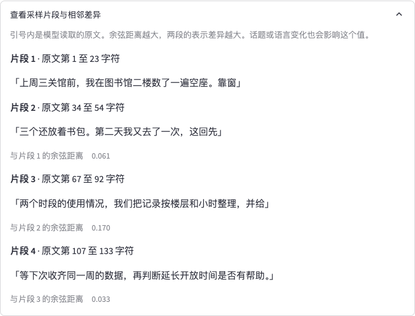
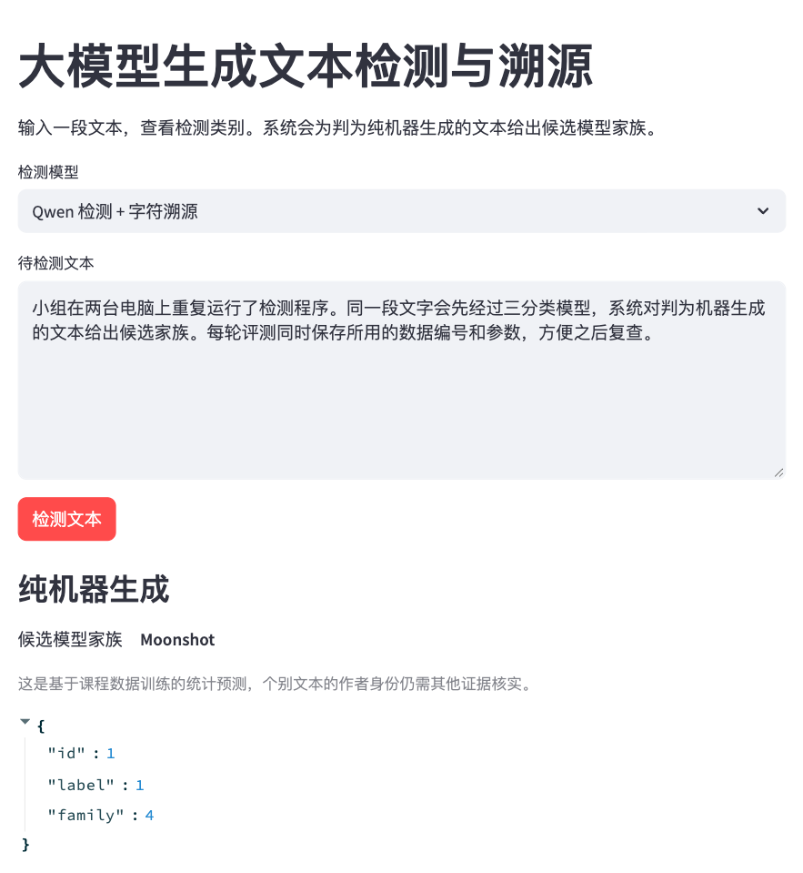

# 大模型生成文本检测与溯源系统

输入一段文本，系统给出「纯人类撰写」「纯机器生成」或「人机协作」三类预测。对于预测为纯机器生成的文本，系统再从八个模型家族中选出一个候选来源。

这是《大模型原理与技术》的三人自由选题项目。默认模型用冻结的 Qwen2.5-0.5B 读取文本首尾，用字符特征区分生成模型家族。新增的四段模型可以在网页中查看采样原文，观察文章不同位置的表示变化。系统也支持 JSONL 批量预测。[实验报告](REPORT.md) · [三项任务完成记录](#三项任务完成记录)

## 四段采样能多识别多少协作文本

从开头、两个中间位置和结尾各取最多 16 个 token，总共最多 64 个。先用四段的平均表示做检测，再用完全相同的文本和模型加入相邻段的差异。测试 A 的 264 篇人机协作文本中，两种方法分别找出 126 篇和 136 篇，同时误报从 61 篇增至 86 篇。首尾模型在同一批 768 篇上的联合得分最高，为 0.6890，网页默认选用它。[对照实验与误差分析](REPORT.md#四段采样与相邻差异) · [完整指标](results/segment_comparison.json)

在网页的 **检测模型** 中选择 **Qwen 四段均值 + 相邻差异**，粘贴文本后点击 **检测文本**。结果下方列出实际读取的原文位置、片段和相邻段的余弦距离。可以用这三个距离观察哪两段变化较大。



## 在这台电脑上演示

工作目录为本项目根目录。已训练的分类器位于 `runs/main/`，Qwen 权重位于 `models/Qwen2.5-0.5B/`。在本机终端启动后，打开终端显示的本地地址，输入文本并点击 **检测文本**。

```bash
/opt/anaconda3/bin/python -m streamlit run app.py
```

本机已经备好官方数据 `data/dataset.zip`、固定划分 `data/course-split/` 和官方测试答案 `data/test_labeled.zip`，可以离线重新训练和评分。

```bash
/opt/anaconda3/bin/python experiment.py --data data/course-split --out runs/local-repeat
/opt/anaconda3/bin/python heldout.py --run runs/local-repeat --input data/course-split --gold data/test_labeled.zip
```



## 从干净环境复现

从个人课程 Fork 获取这一阶段的项目时，可只检出进展分支里的项目目录。

```bash
git clone --filter=blob:none --depth 1 --sparse --branch progress/text-tracing https://github.com/PennyBurden/LLM-Course.git
cd LLM-Course
git sparse-checkout set projects/llm-text-tracing
cd projects/llm-text-tracing
```

推荐 Python 3.11 至 3.13。本次实测版本见报告。先建立虚拟环境，再安装依赖。Windows 可在 PowerShell 运行 `.venv\Scripts\Activate.ps1` 激活环境。

```bash
python -m venv .venv
source .venv/bin/activate
python -m pip install -r requirements-qwen.txt
```

下载赛题仓库中的 `dataset.zip` 和 `test_labeled.zip`，放入本地 `data/` 目录。程序可直接读取 ZIP。首次运行 Qwen 时，Transformers 会获取固定版本的官方权重。也可将已下载的同版模型放入 `models/Qwen2.5-0.5B/` 离线运行。[固定版本的赛题数据](https://github.com/ASCII-LAB/CCKS26-Task6-LLM-Generated-Text-Detect-Trace/tree/09833974f03ca83a52f43830f93913c9a5b26f20) · [Qwen 模型与版本](https://huggingface.co/Qwen/Qwen2.5-0.5B/tree/060db6499f32faf8b98477b0a26969ef7d8b9987)

```bash
python experiment.py --data data/dataset.zip
python heldout.py --input data/dataset.zip --gold data/test_labeled.zip
python -m unittest discover -s tests -v
python -m streamlit run app.py
```

首次训练默认写入 `runs/main/`，包括分类器、逐条验证预测和指标。重复训练会生成带时间的目录，也可用 `--out` 指定一个新目录。评测其他轮次时用 `heldout.py --run 目录`。演示其他轮次时将环境变量 `TRACE_RUN_DIR` 设为该目录。Qwen 自动选择 CUDA、Apple MPS 或 CPU，也可用 `--device cpu` 指定设备。

生成四种基线模型后，在项目根目录执行以下命令即可复现四段实验。两个四段模型、逐条预测及 `summary.json` 写入 `runs/segments/`。网页会自动显示这两个新选项。再次训练时用 `--out` 指定新目录。

```bash
python segment_experiment.py --data data/dataset.zip --gold data/test_labeled.zip
python predict.py --model runs/segments/qwen-segment-change.joblib --text "这里填入待检测的文本。"
```

只跑字符基线时，安装 `requirements.txt` 并执行以下命令即可。已有旧课程固定划分的组员也可以把 `--data` 指向包含 `train.jsonl`、`dev.jsonl`、`dev_gold.jsonl` 的目录。

```bash
python experiment.py --data data/dataset.zip --baseline-only --out runs/baseline
```

报告图直接读取 `results/validation.json`、`results/test_b.json` 和 `results/data_and_families.json`。安装 `matplotlib==3.10.0` 后，执行 `python results/plot_scores.py` 即可重新生成得分图和家族混淆矩阵。

## 单条和批量推理

批量输入是 UTF-8 JSONL，每行包含整数 `id` 和字符串 `text`。同一批次的 ID 唯一。人类与协作预测的 `family` 为 `-1`。家族编号 0 至 7 依次对应 OpenAI、Alibaba、DeepSeek、ByteDance、Moonshot、Google、Anthropic 和 xAI。

```bash
python predict.py --model runs/main/qwen-detect-char-source.joblib --text "这里填入待检测的文本。"
python predict.py --model runs/main/qwen-detect-char-source.joblib --input input.jsonl --output runs/predictions.jsonl
```

## 三项任务完成记录

| 工作 | 本地交付 | 结果记录 |
|---|---|---|
| 数据与家族溯源 | 从官方 ZIP 重建划分，逐 ID 核对训练、验证、测试 A/B 的 126,150 条记录。在全部 19,760 条验证文本上复核字符基线并分析八个家族的错判与漏检 | [核验记录](results/data_and_families.json) · [家族混淆矩阵图](results/family_confusion.png) |
| Qwen 检测与消融 | 离线重训四种基础方案，固定预算比较开头与首尾，再用同样四个片段对照均值和相邻差异 | [四种方案指标](results/validation.json) · [等长窗口实验](results/window_control.json) · [四段实验](results/segment_comparison.json) |
| 评分与演示 | 重跑 768 篇测试 B 文本，按 ID 对齐逆序输入的两份预测，用混淆计数独立复算三项分数。通过单条、批量、网页和评分边界测试 | [复现与演示验收](results/reproduction.json) · [独立测试结果](results/test_b.json) |

本机的复跑模型和两份逐条测试预测保存在 `runs/team-verified/`。下列命令可在项目根目录复核三项交付。模型与数据已就位时可以离线运行。

```bash
python audit_data.py --data data/dataset.zip --compare-split data/course-split --run runs/team-verified
python window_control.py --data data/course-split --run runs/team-verified
python verify_run.py --data data/course-split --reference runs/main --repeat runs/team-verified
```

在新电脑上复做验收时，先按上文生成 `runs/main`，再用 `experiment.py --out runs/team-verified` 独立训练第二次。用 `heldout.py --run runs/team-verified --out runs/team-verified/test_b.json` 配合同一套输入和答案生成独立测试记录。如果只有官方压缩包，三个复核脚本都支持 `--data data/dataset.zip`，数据核验命令可省略 `--compare-split`。

## 课程登记

选题表的领域填 **Others**，题目填 **大模型生成文本检测与溯源系统**。课程将领域 RAG 问答列在方向 01，本项目按方向 08 自由选题组织。组队需按课程说明提前申请并说明贡献。自由选题的代码发布在独立公开仓库，报告通过课程 Fork 提交 PR。课程仓库的实际目录名为 `LLM-Course-Assignments-2026/08-Others/`。报告文件名使用单数形式 `学号-姓名-08-Other-TextTracing.md`。[课程总说明](https://github.com/CAI-testbooks/LLM-Course/blob/main/LLM-Course-Assignments-2026/README.md) · [方向 08 提交说明](https://github.com/CAI-testbooks/LLM-Course/blob/main/LLM-Course-Assignments-2026/08-Others/README.md)
